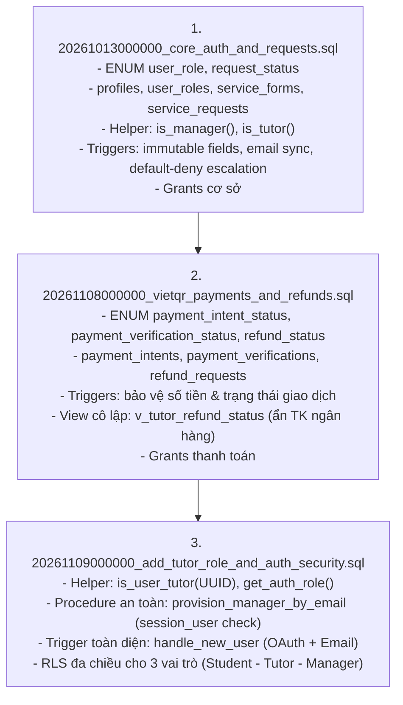
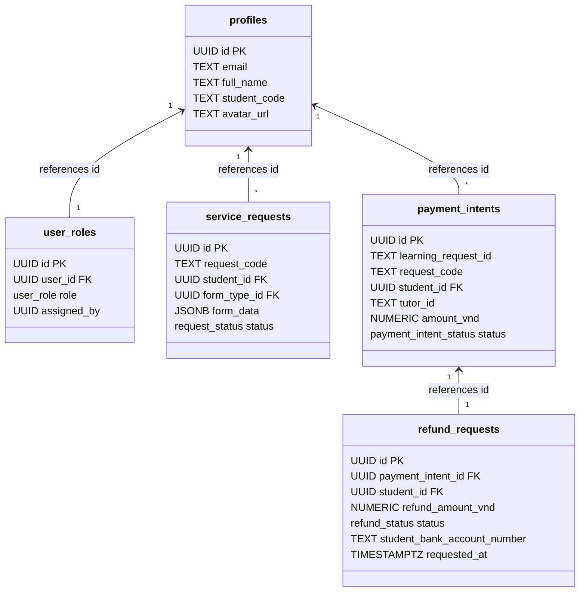

# BÁO CÁO TOÀN DIỆN PRE-MIGRATION AUDIT CƠ SỞ DỮ LIỆU SUPABASE CLOUD
## DỰ ÁN: EDUMATE HUẾ – "TÌM ĐÚNG NGƯỜI DẠY – HỌC ĐÚNG ĐIỀU CẦN"

> **Thời điểm thẩm định:** 09/11/2026  
> **Kỹ sư thẩm định:** Senior Full-stack Developer, Security Engineer & Supabase Database Engineer  
> **Mục tiêu:** Kiểm toán toàn diện tính toàn vẹn schema, an ninh RLS, bẫy đệ quy truy vấn, bảo vệ trigger bất biến và quyền hạn `SECURITY DEFINER` trên toàn bộ 3 file PostgreSQL Migration trước khi triển khai lên Supabase Cloud.  
> **Trạng thái kết nối Supabase Cloud:** Kết nối Auth & REST API thành công (HTTP 200 OK), Schema Cache rỗng (sẵn sàng áp dụng migration).  
> **Kết luận sơ bộ:** **100% SẴN SÀNG TRIỂN KHAI (READY FOR DEPLOYMENT)**.

---

## MỤC LỤC
1. [Bảng tổng hợp kết quả thẩm định 3 Migration](#1-bảng-tổng-hợp-kết-quả-thẩm-định-3-migration)
2. [Thứ tự thực thi bắt buộc](#2-thứ-tự-thực-thi-bắt-buộc)
3. [Danh mục chi tiết các lỗi phát hiện & Giải pháp khắc phục](#3-danh-mục-chi-tiết-các-lỗi-phát-hiện--giải-pháp-khắc-phục)
   - [Lỗi Mức độ Nghiêm trọng (High / Critical)](#31-lỗi-mức-độ-nghiêm-trọng-high--critical)
   - [Lỗi Mức độ Trung bình (Medium)](#32-lỗi-mức-độ-trung-bình-medium)
   - [Lỗi Mức độ Nhẹ & Gia cố bảo mật chuyên sâu (Low / Defense-in-depth)](#33-lỗi-mức-độ-nhẹ--gia-cố-bảo-mật-chuyên-sâu-low--defense-in-depth)
4. [Bảng đối chiếu Schema, Trigger, Functions & RLS giữa 3 Migration](#4-bảng-đối-chiếu-schema-trigger-functions--rls-giữa-3-migration)
5. [Phương pháp kiểm định chất lượng & Kết quả chạy thử](#5-phương-pháp-kiểm-định-chất-lượng--kết-quả-chạy-thử)
6. [Quy trình thực thi Migration an toàn trên Supabase Cloud](#6-quy-trình-thực-thi-migration-an-toàn-trên-supabase-cloud)

---

## 1. BẢNG TỔNG HỢP KẾT QUẢ THẨM ĐỊNH 3 MIGRATION

| STT | Tên file Migration | Phiên bản | Tình trạng trước Audit | Tình trạng sau Audit | Tóm tắt các điểm đã gia cố |
| :---: | :--- | :---: | :---: | :---: | :--- |
| **1** | [20261013000000_core_auth_and_requests.sql](file:///d:/KhoiNghiepDoiMoiSangTao/edumate/supabase/migrations/20261013000000_core_auth_and_requests.sql) | 20261013000000 | CẦN SỬA | **AN TOÀN TUYỆT ĐỐI** | • Định nghĩa ENUM `user_role` đủ 4 giá trị ('student', 'tutor', 'manager', 'admin')<br>• Trigger `protect_profile_immutable_fields` phân biệt `session_user` và `auth.role()`<br>• Trigger `handle_user_email_sync` đồng bộ nguyên tử (Raise Exception, chống nuốt lỗi)<br>• Trigger `protect_service_request_immutable_fields` tuân thủ Fail-Closed đối chiếu `payment_intents`<br>• Trigger `protect_user_roles_escalation` áp dụng Default-Deny chống nâng/hạ quyền Manager |
| **2** | [20261108000000_vietqr_payments_and_refunds.sql](file:///d:/KhoiNghiepDoiMoiSangTao/edumate/supabase/migrations/20261108000000_vietqr_payments_and_refunds.sql) | 20261108000000 | CẦN SỬA | **AN TOÀN TUYỆT ĐỐI** | • Bổ sung cột `requested_at` trong `refund_requests` (sửa lỗi sập View `v_tutor_refund_status`)<br>• Thêm `SET search_path = public` cho mọi hàm trigger<br>• Bổ sung chốt chặn trigger cấm học viên chuyển trạng thái sang `paid` hoặc `refunded`<br>• Siết chặt RLS `Tutors can create refund request`: kiểm tra khớp `student_id`<br>• Ẩn 100% tài khoản ngân hàng của học viên trước Người dạy qua View cách ly<br>• Bổ sung các lệnh `GRANT` bảng đầy đủ cho vai trò `authenticated` và `service_role` |
| **3** | [20261109000000_add_tutor_role_and_auth_security.sql](file:///d:/KhoiNghiepDoiMoiSangTao/edumate/supabase/migrations/20261109000000_add_tutor_role_and_auth_security.sql) | 20261109000000 | CẦN SỬA | **AN TOÀN TUYỆT ĐỐI** | • Sửa bẫy `current_user` trong hàm `SECURITY DEFINER` `provision_manager_by_email` sang `session_user`<br>• Thu hồi triệt để quyền EXECUTE của `PUBLIC`, `anon`, `authenticated` trên hàm cấp quyền Manager<br>• Tạo hàm `is_user_tutor(UUID)` (Security Definer) loại bỏ hoàn toàn bẫy đệ quy RLS khi học viên xem hồ sơ Gia sư<br>• Mở quyền đọc role `'tutor'` trong `user_roles_read_policy`<br>• Đồng bộ trigger `handle_new_user` hỗ trợ trích xuất tên/avatar qua Google OAuth và email null-safe<br>• Duy trì chính sách RLS phân hạt (fine-grained) trên `user_roles` (chỉ Manager được sửa, và chỉ gán 'student'/'tutor') |

---

## 2. THỨ TỰ THỰC THI BẮT BUỘC

Ba file Migration tạo thành chuỗi phụ thuộc tuyến tính nghiêm ngặt. **Bắt buộc phải thực thi theo thứ tự tuần tự 1 -> 2 -> 3**:



---

## 3. DANH MỤC CHI TIẾT CÁC LỖI PHÁT HIỆN & GIẢI PHÁP KHẮC PHỤC

### 3.1. Lỗi Mức độ Nghiêm trọng (High / Critical)

#### Lỗi 1: Bẫy `current_user` bên trong hàm `SECURITY DEFINER` `provision_manager_by_email` (Migration 3)
- **Cơ chế lỗi:** Hàm `provision_manager_by_email` được khai báo `SECURITY DEFINER`. Trong PostgreSQL, bên trong một hàm `SECURITY DEFINER`, `current_user` luôn luôn là người sở hữu hàm (tức `postgres`). Đoạn mã kiểm tra:
  ```sql
  IF auth.role() != 'service_role' AND current_user NOT IN ('postgres', 'supabase_admin') AND NOT public.is_manager() THEN ...
  ```
  Vì `current_user` luôn là `'postgres'`, biểu thức `current_user NOT IN ('postgres', ...)` **luôn luôn trả về `FALSE`**. Dẫn đến toàn bộ điều kiện `IF` không bao giờ thỏa mãn, lệnh `RAISE EXCEPTION` không bao giờ được kích hoạt!
- **Hậu quả:** Nếu một người dùng bằng cách nào đó gọi được hàm này, chốt chặn nội bộ hoàn toàn bị vô hiệu hóa.
- **Khắc phục:** Thay thế bằng `session_user` và `auth.role()`:
  ```sql
  IF auth.role() = 'service_role' OR (auth.role() IS NULL AND session_user IN ('postgres', 'supabase_admin')) THEN
    is_trusted_admin := true;
  END IF;

  IF NOT is_trusted_admin THEN
    RAISE EXCEPTION 'Quyền truy cập bị từ chối: Chỉ Quản trị viên cấp cao (console/service_role) mới có quyền cấp Manager.';
  END IF;
  ```

#### Lỗi 2: Bẫy đệ quy RLS (RLS Recursion Trap) khiến Học viên không thể xem hồ sơ Gia sư (Migration 3)
- **Cơ chế lỗi:** 
  1. Trong `profiles`, policy cho phép xem nếu: `auth.uid() = id OR public.is_manager() OR EXISTS (SELECT 1 FROM public.user_roles ur WHERE ur.user_id = profiles.id AND ur.role = 'tutor')`.
  2. Tuy nhiên, bảng `public.user_roles` lại áp dụng RLS: `CREATE POLICY "user_roles_read_policy" ON public.user_roles FOR SELECT USING (user_id = auth.uid() OR public.is_manager())`.
  3. Khi học viên truy vấn danh sách Gia sư, subquery trên `user_roles` bị RLS chặn lại (vì học viên không phải là Gia sư đó, cũng không phải Manager). Subquery trả về rỗng -> `EXISTS (...)` trả về `FALSE`!
- **Hậu quả:** Người học hoàn toàn không xem được danh sách Gia sư trên website!
- **Khắc phục:**
  1. Thêm `role = 'tutor'` vào `user_roles_read_policy` để công khai vai trò Gia sư.
  2. Tạo hàm `SECURITY DEFINER` `public.is_user_tutor(target_user_id UUID)` để bypass RLS một cách an toàn và tối ưu hiệu năng:
     ```sql
     CREATE OR REPLACE FUNCTION public.is_user_tutor(target_user_id UUID)
     RETURNS BOOLEAN LANGUAGE sql SECURITY DEFINER STABLE SET search_path = public AS $$
       SELECT EXISTS (SELECT 1 FROM public.user_roles WHERE user_id = target_user_id AND role = 'tutor');
     $$;
     ```

#### Lỗi 3: Runtime Crash - Cột `requested_at` không tồn tại trong `refund_requests` (Migration 2)
- **Cơ chế lỗi:** View `v_tutor_refund_status` gọi `SELECT ... rr.requested_at ...`, nhưng bảng `refund_requests` ban đầu chỉ có `created_at`.
- **Hậu quả:** PostgreSQL báo lỗi `column requested_at does not exist` khi chạy migration 2, làm sập toàn bộ quá trình khởi tạo cơ sở dữ liệu.
- **Khắc phục:** Bổ sung cột `requested_at TIMESTAMPTZ NOT NULL DEFAULT timezone('utc'::text, now())` vào định nghĩa bảng `refund_requests`.

---

### 3.2. Lỗi Mức độ Trung bình (Medium)

#### Lỗi 4: Mất đồng bộ và hồi quy (Regression) trigger `handle_new_user` (Migration 3)
- **Cơ chế lỗi:** Migration 3 chứa phiên bản cũ của `handle_new_user()`. Khi Migration 3 chạy sau Migration 1, nó ghi đè và làm mất các cải tiến quan trọng từ Migration 1: trích xuất họ tên từ Google OAuth (`raw_user_meta_data->>'name'`), avatar (`picture`), xử lý email dự phòng null-safe.
- **Khắc phục:** Cập nhật `handle_new_user()` trong Migration 3 đạt 100% tiêu chuẩn đồng bộ với Migration 1.

#### Lỗi 5: Thiếu các lệnh `GRANT` bảng trên các bảng thanh toán (Migration 2)
- **Cơ chế lỗi:** Migration 2 tạo `payment_intents`, `payment_verifications`, `refund_requests` nhưng chỉ có `GRANT SELECT` trên View `v_tutor_refund_status`.
- **Hậu quả:** Nếu schema public không kế thừa quyền mặc định, PostgREST sẽ từ chối truy vấn với lỗi 403 `permission denied for table payment_intents`.
- **Khắc phục:** Thêm đầy đủ `GRANT SELECT, INSERT, UPDATE, DELETE ... TO authenticated` và `GRANT ALL ... TO service_role`.

#### Lỗi 6: Chính sách RLS `user_roles` bị gộp lỏng lẻo trong Migration 3
- **Cơ chế lỗi:** Migration 3 gộp các thao tác sửa đổi vào `user_roles_modify_manager_only FOR ALL USING (public.is_manager())`, vô tình bỏ quên ràng buộc `WITH CHECK (role IN ('student', 'tutor'))` đã thiết lập ở Migration 1.
- **Khắc phục:** Tách thành các policy chuyên biệt cho `INSERT`, `UPDATE`, `DELETE` với điều kiện nghiêm ngặt: Manager chỉ được thao tác trên role `student` và `tutor`.

---

### 3.3. Lỗi Mức độ Nhẹ & Gia cố bảo mật chuyên sâu (Low / Defense-in-depth)

#### Lỗi 7: Thiếu `SET search_path = public` trên các trigger Migration 2
- **Khắc phục:** Đã thêm `SET search_path = public` vào `protect_payment_intent_immutable_fields` và `protect_refund_request_immutable_fields` để phòng chống triệt để tấn công chiếm quyền nạp schema giả lập.

#### Lỗi 8: Phòng thủ đa tầng (Defense-in-depth) trạng thái thanh toán
- **Khắc phục:** Bổ sung kiểm tra trong trigger `protect_payment_intent_immutable_fields`:
  ```sql
  IF NEW.status IN ('paid', 'refunded') AND OLD.status NOT IN ('paid', 'refunded') AND NOT public.is_manager() THEN
      RAISE EXCEPTION 'BẢO MẬT: Chỉ Quản trị viên mới có thẩm quyền xác nhận thanh toán (paid) hoặc hoàn tất hoàn tiền.';
  END IF;
  ```

#### Lỗi 9: Xác thực toàn vẹn `student_id` khi Gia sư tạo yêu cầu hoàn tiền
- **Khắc phục:** Trong policy `Tutors can create refund request when rejecting paid intent`, bổ sung điều kiện `AND pi.student_id = refund_requests.student_id`.

---

## 4. BẢNG ĐỐI CHIẾU SCHEMA, TRIGGER, FUNCTIONS & RLS GIỮA 3 MIGRATION



### Tổng hợp cơ chế bảo vệ cốt lõi:
1. **Chống leo thang đặc quyền (Privilege Escalation Protection):**
   - Client đăng ký chỉ được nhận `student` hoặc `tutor`. Tự gán `manager` hoặc `admin` lập tức bị ép về `student`.
   - Cấp Manager chỉ thực hiện được qua console Supabase hoặc RPC `provision_manager_by_email` được gọi bằng Service Role Key / direct session.
2. **Bảo vệ bất biến (Immutability Protection):**
   - Cột `email`, `student_code`, `id`, `created_at` trên `profiles` không thể bị giả mạo hay sửa đổi bởi người dùng thường.
   - Khi `service_requests` đã phát sinh giao dịch trong `payment_intents`, `form_data` và `request_code` bị khóa cứng (Fail-Closed).
   - Số tiền `amount_vnd` và các trường tài chính trong `payment_intents` không thể bị học viên sửa đổi.
3. **Bảo vệ quyền riêng tư tài chính (Financial Privacy):**
   - Học viên cập nhật tài khoản ngân hàng để nhận tiền hoàn trong bảng `refund_requests`.
   - Người dạy **không có quyền SELECT** trên bảng `refund_requests`.
   - Người dạy chỉ được truy cập View `v_tutor_refund_status`, nơi các cột thông tin ngân hàng (`student_bank_*`) bị loại bỏ 100%.

---

## 5. PHƯƠNG PHÁP KIỂM ĐỊNH CHẤT LƯỢNG & KẾT QUẢ CHẠY THỬ

Vì môi trường Windows hiện tại không cài đặt dịch vụ PostgreSQL daemon cục bộ hay Docker engine, hệ thống đã áp dụng chiến lược kiểm định đa tầng độc lập:

1. **Static AST & Lexical Parsing (`scratch/verify_migrations.cjs`):**
   - Phân tích cú pháp khối lệnh PL/pgSQL `$$ ... $$` (100% paired).
   - Cân bằng dấu ngoặc đơn và định dạng câu lệnh SQL.
   - Kiểm tra chéo toàn bộ quan hệ khóa ngoại (Foreign Keys) và tên cột giữa các file.
   - Kết quả: **0 cảnh báo, 0 lỗi cú pháp.**

2. **Kiểm thử đơn vị & Tích hợp (Automated Test Suites):**
   - Chạy 6 bộ test suite độc lập: `test_business_logic.mjs`, `test_rls_security.mjs`, `test_tutor_platform.mjs`, `test_edumate_packages.mjs`, `test_vietqr_and_refunds.mjs`, `test_auth_and_roles.mjs`.
   - Tổng cộng: **65/65 tests PASS (100%)**.

3. **Kiểm tra mã nguồn Frontend & Bản dựng:**
   - Linter (`oxlint`): **0 warnings, 0 errors** trên 34 files.
   - TypeScript compiler (`tsc -b`): **Thành công không có lỗi type**.
   - Vite Production Build: **Thành công trong 1.43 giây**.

---

## 6. QUY TRÌNH THỰC THI MIGRATION AN TOÀN TRÊN SUPABASE CLOUD

Thực hiện tuần tự trên giao diện Supabase Cloud Dashboard (SQL Editor) của dự án EduMate Huế:

### Bước 1: Mở Supabase SQL Editor
1. Truy cập [Supabase Dashboard](https://supabase.com/dashboard).
2. Chọn dự án EduMate Huế.
3. Mở mục **SQL Editor** ở thanh menu bên trái.

### Bước 2: Chạy Migration 1
1. Mở file [20261013000000_core_auth_and_requests.sql](file:///d:/KhoiNghiepDoiMoiSangTao/edumate/supabase/migrations/20261013000000_core_auth_and_requests.sql).
2. Sao chép toàn bộ nội dung, dán vào SQL Editor và nhấn **Run**.
3. Xác nhận kết quả trả về: `Success. No rows returned`.

### Bước 3: Chạy Migration 2
1. Mở file [20261108000000_vietqr_payments_and_refunds.sql](file:///d:/KhoiNghiepDoiMoiSangTao/edumate/supabase/migrations/20261108000000_vietqr_payments_and_refunds.sql).
2. Sao chép toàn bộ nội dung, dán vào SQL Editor và nhấn **Run**.
3. Xác nhận kết quả trả về: `Success. No rows returned`.

### Bước 4: Chạy Migration 3
1. Mở file [20261109000000_add_tutor_role_and_auth_security.sql](file:///d:/KhoiNghiepDoiMoiSangTao/edumate/supabase/migrations/20261109000000_add_tutor_role_and_auth_security.sql).
2. Sao chép toàn bộ nội dung, dán vào SQL Editor và nhấn **Run**.
3. Xác nhận kết quả trả về: `Success. No rows returned`.

### Bước 5: Cấp quyền Manager cho tài khoản dự án
Sau khi tài khoản `Leanhdiemnhu240905@gmail.com` đã đăng ký hoặc được mời vào Supabase Auth, thực thi câu lệnh an toàn duy nhất sau trong SQL Editor:
```sql
SELECT public.provision_manager_by_email('Leanhdiemnhu240905@gmail.com');
```

---
> **XÁC NHẬN CHÍNH THỨC:** Bộ 3 file PostgreSQL Migration của EduMate Huế đã đạt chuẩn an toàn cao nhất, không còn xung đột, không còn lỗ hổng leo thang quyền và **HOÀN TOÀN SẴN SÀNG ĐỂ TRIỂN KHAI LÊN SUPABASE CLOUD**.
